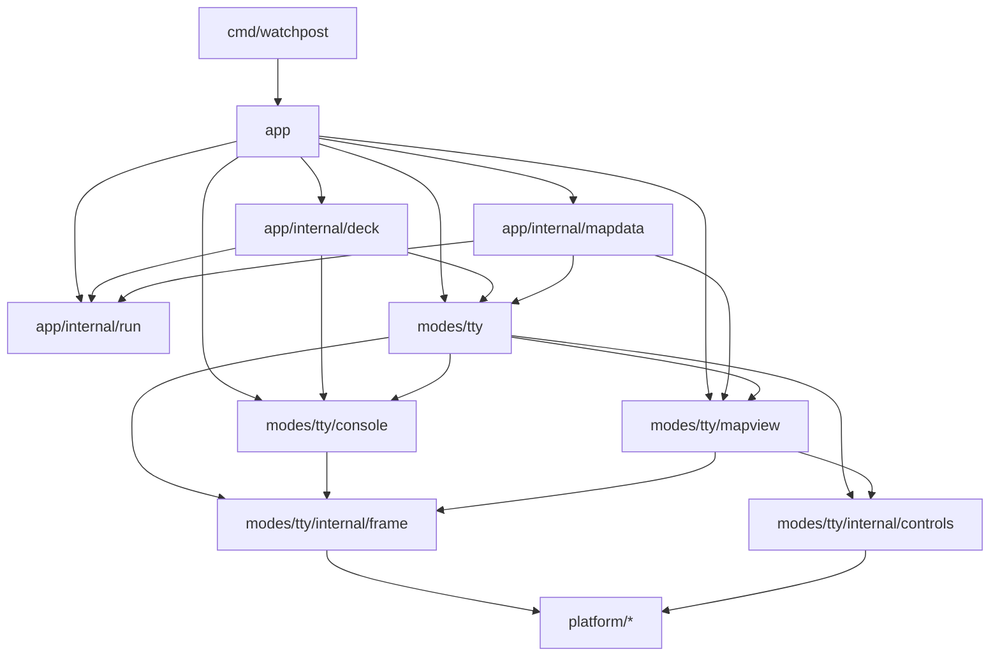
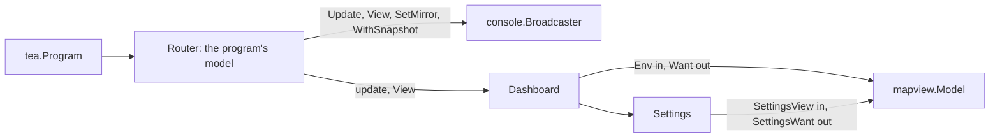
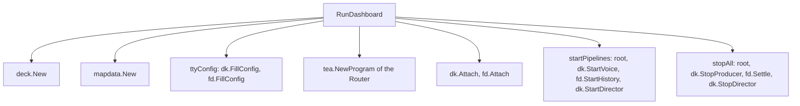

# The planned architecture

This page draws the layout 0.19.6 builds: which packages exist when it closes, what each holds, and
which way the imports run. It is drawn from the settled package map (`../02-analysis/package-map.md`)
and the three PLAN designs filed beside it:

- `design-CK-console-kit.md`: step 1, the kit, the console and the test support;
- `design-MS-map-seam.md`: steps 2a and 2b, the map;
- `design-AP-app-split.md`: `app`'s split.

Where a ruling chose differently from a design, the ruling stands (D-21 to D-32, A-19 to A-33).
Signatures and field lists are in the designs. This page carries no implementation (0.18.0 D-13).

## The packages when 0.19.6 closes

| Package | Holds | Imported by |
|---|---|---|
| `modes/tty` | the Router (the program's one model), the Observer's core (`Dashboard`), Settings, the windows, the key routing, the window stack, the post-update steps | `app`, `deck`, `mapdata`; `cmd/watchpost`'s tests only |
| `modes/tty/console` | the Broadcaster console: `Broadcaster`, `New(Opening)`, `SetMirror`, its six messages | `modes/tty`, `app`, `deck` |
| `modes/tty/mapview` | the map and its Propagation windows: `Model`, `Env`, `Want`, `Hooks`, the map's Settings rows and choices (D-25) | `modes/tty`, `app`, `mapdata` |
| `modes/tty/internal/frame` | the parts of a frame more than one package draws: masthead, cursor, tick, memo counters, the row, `NoTransmitter` (A-31, A-33) | `modes/tty`, `console`, `mapview` |
| `modes/tty/internal/controls` | the D-147 controls: pickers, chips, toggles, their flash | `modes/tty`, `mapview` |
| `modes/tty/internal/ttytest` | the memo guard's engine and the pure test helpers | `_test.go` files under `modes/tty` only |
| `app` | the composition root: `RunDashboard`, the pipelines, the pool, `commit`, the diagnostics | `cmd/watchpost` |
| `app/internal/deck` | the shared deck, whole: the radio deck, the arbiter, MasterControl, the air scope and fences, the bed, the Director's executors, the Producer and Composer | `app` |
| `app/internal/mapdata` | the map's feeds and memos, the zone shapes, the propagation client, the timing instrument, the history | `app` |
| `app/internal/run` | seven helpers one run shares: `UserAgent`, `EveryTick`, `SavePreference`, the cache directories, `LockedCopy`, `RequestStats` | `app`, `deck`, `mapdata` |
| `app/internal/apptest` | `app`'s pure test helpers | `_test.go` files under `app` only |

## The import graph

**The rules the gates hold** (batch 0, package map §4 item 9, A-12):
- No edge points up: `modes`, `platform` and `domains` never import `app`, and `platform` never imports
  `modes`.
- `deck` and `mapdata` never import each other (DQ-6).
- `ttytest` and `apptest` are imported by `_test.go` files only (D-15, A-24).
- No type alias into the split trees survives a batch (C-4, GP-11).
- Nothing outside `modes/tty` imports `frame`, `controls` or `ttytest`; Go's `internal/` rule holds it
  (C-5).

`NoTransmitter`, the one constant the map reads from the console (`modes/tty/map_prop_origin.go:propOriginNow`), moves to
the kit in B2, so `mapview` does not import `console` (A-31).

## How the Router composes the two surfaces

- The Router is the program's model, always (R4, `app/router_owner_test.go:TestTheProgramsModelIsAlwaysTheRouter`). Both surfaces are
  concrete fields; nothing is boxed in an interface on the frame path (`modes/tty/router.go:View`).
- The console takes its construction values once (`Opening`) and its per-update values by
  `SetMirror`, a pointer receiver measured with no copy (A-21). Its clock is the Dashboard's, handed
  over by `NewRouter` (D-21).
- The map reads the Dashboard's state only through `Env`, built per call, and changes the root's state
  only through `Want`, which the root applies (A-22). The nine post-update steps stay in the root's
  `Dashboard.update`, in today's order (R4).
- The map's hooks are held once, behind `Config.Map` (A-22, R9).

## How the composition root composes the deck and the map data

- Today's order is kept step for step (R1, A-23): the deck's start and stop are two methods each,
  because the map data's steps sit between them today.
- The deck and the map data hold the root's `livePipelines.mu` by pointer (D-16). No section under it
  calls into another package (A-19), and the static check holds that.
- The deck's whole exported surface is held by a test: 62 names, in three tiers (design AP-1.5).

## What changes for a reader

| Today | After |
|---|---|
| `modes/tty`: 31,346 lines in 88 files | the root about 16,900; the console about 3,900; the map about 10,500; the kit, controls and test support small |
| `Dashboard`: 752 methods in 68 files | 374 in 38 (A-27) |
| the map reads 72 of the model's symbols | 23 through `Env` and `Want` (93 by type falls to 40) |
| the console reads 13 of the Observer's symbols | 0, held by the compiler |
| `app`: 20,184 lines in 76 files; `livePipelines` 55 fields and 108 methods | the root's `livePipelines` keeps 20 fields and 34 methods; the deck and the map data each hold their own |

These are M3's projected figures. Its targets are ratified at PLAN exit (D-13).
