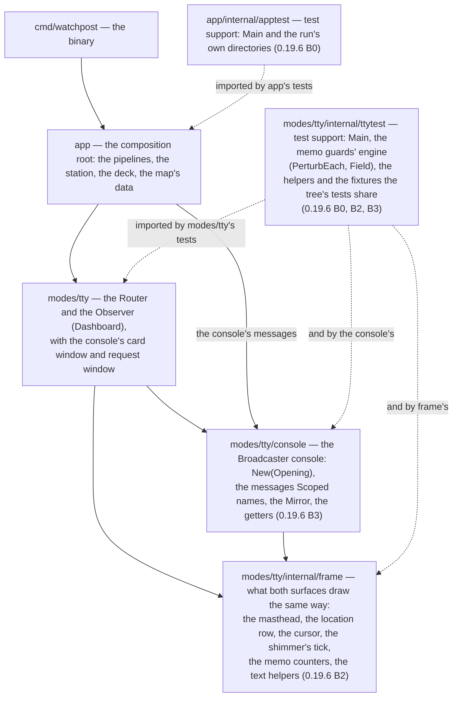

# As built: the packages of modes/tty and app

**This page is kept in step with the code, batch by batch.** The build log
(`04-development/build-log.md`) says what each batch moved, and the atlas draws from the diagram
below (`go run ./tools/atlas`). The layout the release ends at is the plan's (`architecture.md`),
which this page replaces batch by batch (package map §9).

## The packages, and what imports what

Each solid arrow is an import by non-test code; each dotted one, an import by tests alone. An
internal package sits under the tree that owns it, so only that tree's packages can import it.
`ttytest` and `apptest` are test support, which `make lint-imports` keeps to test files.

## What reads what

- **The console reads no Router or Observer state.** The Router opens it with `New(Opening)` and
  reaches it through the messages `Scoped` names, `SetMirror`, `SetListenerMuted`, `WithSnapshot`,
  `WithRecent` and its getters; `modes/tty` imports it, so the compiler refuses the other direction.
  The Observer's window for a console card stays in the root, `card_window.go`, drawing what the
  console hands it.
- **The kit reads no surface's model.** `frame` takes what it draws as parameters, from the
  published snapshot (`platform/snapshot`) and the drawing layer (`platform/render`); both surfaces
  import it, so the compiler refuses the other direction. Its declared inputs are in its `doc.go`.
- **Each package's files are mapped in its `doc.go`**, and `TestEveryFileIsInItsPackagesMap` holds
  every non-test file to a row.
- **Every package with tests under a tree calls that tree's `Main`** from its `TestMain`
  (`TestEveryPackageUnderTheTwoTreesCarriesItsParentsTestMain`), so a package a batch creates
  stands on the same ground as the one it came from.
