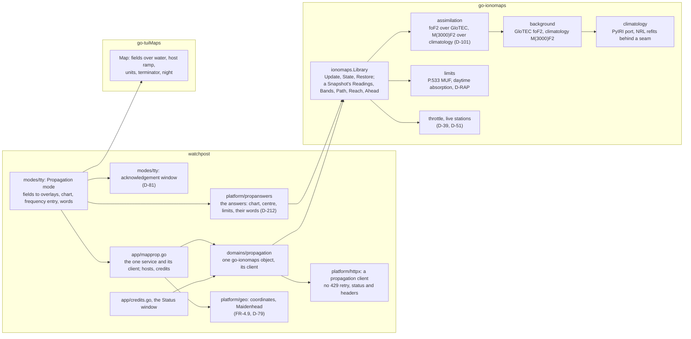

# Architecture

## Summary

**One place, three projects.**
- **watchpost** shows the reference chart in its map window's Propagation mode (D-21, D-76).
- **go-ionomaps** computes the fields and the answers (D-40, D-76).
- **go-tuiMaps** draws them (D-32 to D-36, D-65).

Nothing is fetched until the mode opens and its acknowledgement has been shown (D-81). The library is
asked through one object per process, on its own HTTP client that never retries a 429 (FR-4.4, FR-4.8).

watchpost's structure is kept:
- `domains/` are data sources;
- `platform/` is shared leaves;
- `modes/` are surfaces;
- `app/` is the composition root, and the only package that names a domain and what draws (`scripts/lint-imports.sh`; 0.18.0's plan, "Where new code lives").

## The pieces



| Path | Holds | Why there |
|---|---|---|
| `modes/tty/map_prop*.go` (new) | The Propagation mode beside Radar and Forecast (`modes/tty/map_temp.go:mapMode` names the modes); the chart; the frequency entry; the hour step; the words; the acknowledgement window | every window is a file of package `tty`; the closed-set guards are package-internal |
| `modes/tty/dashboard.go:Config` | two seams beside `MapTemperature`: `PropagationUpdate func(ctx, opts ionomaps.UpdateOptions) <-chan PropagationResult` (the update's one owner, A-30; the Settings' options whole: the reference circuit's noise, D-187, and the no-readings correction, D-105) and the answers in `platform/propanswers` (D-212): pure functions of the snapshot and an ask - the origin, the near-vertical radius and the targets, the continents and a place found (D-204) - to rows, limits and words, which the window calls off the UI goroutine and a later mode (D-27, D-28) asks with targets of its own | the window cannot import `domains/`: the update comes through the app's function; the answers, holding no state and fetching nothing, are a platform package it imports |
| `app/mapprop.go` (new) | the one service over its own client, made on the first update; the Status window's hosts and the sources' credits; the window turns the fields into `tuimaps.Grid` overlays itself (`modes/tty/map_prop_draw.go:fieldGrid`) and asks `platform/propanswers` for the answers | the only package that may name a domain and what draws |
| `domains/propagation/` (new) | the one go-ionomaps object per process; the fetcher it is given; the acknowledgement's record read before the first fetch | a data source is a domain |
| `platform/geo/coords.go`, `maidenhead.go` (new) | one finite-checked coordinate parser and the Maidenhead parser, used by every resolver (FR-4.9, D-79) | shared and pure |
| `platform/httpx/` (existing) | a client built for propagation: no retry on 429, status and headers returned on every outcome, no shared pacing hold (FR-4.4) | the single door |
| `domains/locations/resolver.go` (existing) | the coverage gate made mode-aware (`domains/locations/resolver.go:ResolveAnywhere`) | where the gate is |
| `platform/history/` (existing) | #27's fix only (FR-6.5) | the store |

## Opening the mode

```mermaid
sequenceDiagram
  participant L as Listener
  participant W as Propagation mode (UI goroutine)
  participant A as platform/propanswers
  participant P as domains/propagation (the update's one owner)
  participant I as go-ionomaps
  participant N as GIRO / NOAA
  L->>W: the mode's key
  W->>W: acknowledgement seen? if not, show it (Enter/Esc)
  W->>P: PropagationUpdate(): an update of its own (go-ionomaps runs one at a time, C-2)
  Note over P: its own context and a 60 s deadline; a keypress never cancels it; closing the mode or the app's end does
  P->>I: Update(ctx)
  I->>I: throttle (D-39): a cancelled burst still spends the hour; too soon, answer from the last field
  I->>N: NOAA (GloTEC newest by name or index, the solar indices daily, D-RAP)
  N-->>I: replies
  I-->>P: Snapshot 1: GloTEC and the climatology, GIRO due: said StationsNext (D-183)
  P-->>W: snapshot 1 shown, "asking GIRO's stations"
  W->>P: PropagationUpdate() again at once (StationsNext)
  P->>I: Update(ctx)
  I->>N: GIRO since the last reading (one burst, at most 40)
  N-->>I: replies
  I-->>P: Snapshot 2: the stations up to an hour old assimilated (D-184)
  P-->>W: snapshot ready (Computed, inputs' times, stations)
  W->>A: propanswers.WorkChart / WorkCentre (snapshot, ask): in a command, off the UI goroutine
  A->>A: best bands for the origin's area and each target, the centre's, limits and words
  A-->>W: rows and words, kept under a key of everything they came from
  W-->>L: the picture or the words
  Note over W,P: while open, the refresh tick (10 min default) or the refresh-now key starts the next update
```

**The update and the answers are separate** (FR-1.17, FR-4.8; L-F9, P-4, P-5, P-6, A-29):
- **One owner runs the update.** `domains/propagation` runs each update asked for in its own command - go-ionomaps runs one `Update` at a time under its own lock, so one asked while another runs waits and is answered from what it fetched, and each caller gets its own result (C-2) - with its own context and a 60 s deadline (a burst of 39 took 36 s in PLAN), driven by a refresh tick while the mode is open (FR-4.10) or by the refresh-now key (D-120). A keypress never cancels it; closing the mode does (FR-4.2), and so does the app's end, before its wait for the update to keep GIRO's state (R6T-1); a cancelled GIRO burst still spends the hour's budget (D-39). How the update spends its deadline and orders GIRO's burst - the time budget, what each ask's end is evidence of, a burst's order and how it ends - is one model, go-ionomaps' update's timing model (`06_docs/02_features/go-ionomaps/03-architecture-design/update-timing-model.md` in that repository; D-312, D-314), and watchpost's part of it is its section 7. NOAA is fetched first: when GIRO is due, that update returns its snapshot said `StationsNext` and the window shows it and asks again at once, and the second update makes the burst (D-183), so a first picture comes before the GIRO burst ends.
- **Answers come from the last snapshot.** They are pure functions of it (R-2), asked in their own command, so an hour step or a new frequency is answered from what is held, never behind a GIRO burst: the reach, about 0.2 s, once the hour stands and one at a time, the latest wanted winning (D-227).
- **Their memo key carries every input**: the snapshot's `Computed` and which rebuild of it is shown (A-68), the origin, the hour, the frequency, the near-vertical radius (D-100) and the target set; a new snapshot or a changed Setting misses the memo; the centre is keyed separately. FR-8.2's guard covers this key.
- **The map follows the UI mode** (D-193, D-195, A-51, A-52). One table, `mapRoles`, gives each UI mode whose place the map is on, whether the station's service area is drawn, whether `[` and `]` step through the places, and its Propagation origin and whether the map's centre is a target. Observer is on the selected place and answers from the centre as the map pans; the Broadcaster is on its station (its transmitter; the selected place, said, when none is set), its service area drawn in every mode through go-tuiMaps' `Zone` role (its L-8), and answers from the station, the centre a target. `g` on the console opens the same window. The origin is worked out in Update and kept for the frame. A UI mode added later (Analyst, D-27) is one row, and a mode with none fails its test.
- **A returned snapshot is immutable** (fresh slices on every update).
- **Only the hour on screen** is converted for go-tuiMaps (D-112).

## go-ionomaps, as watchpost uses it

The signatures are go-ionomaps' own: its package documentation (`go doc -all
github.com/branden-thompson/go-ionomaps`) and its API review (go-ionomaps
`06_docs/02_features/go-ionomaps/03-architecture-design/api-review.md`, D-216). They are not copied here,
where they went stale (BUILD red team D-F4). What watchpost relies on, by the role it plays:

| watchpost's need | go-ionomaps |
|---|---|
| one library object per process, over the propagation client (FR-4.8) | `New(fetcher, Options)`; the fetcher asks only the hosts `Sources()` names (FR-4.7) |
| GIRO's throttle across restarts (FR-4.12, D-213) | `(*Library).State()` after each update, `Restore(bytes)` at start; GIRO's throttle and the kept solar flux are taken each on its own, a part refused starting as new and named in the diagnostics (`ErrBadGIROState`, `ErrBadMean`), a state not the library's starting whole as new (`ErrBadState`) |
| an update with the Settings' options (FR-4.10, FR-4.11) | `Update(ctx, UpdateOptions{Noise, CorrectNoReadings, NoStations})`; the snapshot's `Reason` says fresh, too soon, GIRO paused, offline, stations next or unfinished; `ErrNoField` when there is none |
| the field drawn, its age and its inputs (FR-1.1 to FR-1.6, FR-5) | `Snapshot.Now` (its hour's MUF(3000) and foF2 fields), `Computed`, `Inputs` (with `Unread`, `GloTECFilled`, `NoStations`), `Background`, `Scales`, `Offset` |
| the hours ahead (FR-1.13, D-109) | `Snapshot.Ahead(k)`: a snapshot of its own, typical, with none of now's disturbance or offset (L-F2) |
| the answers (FR-1.9 to FR-1.16) | `Readings`, `Bands`, `Path`, `Reach` on a snapshot, each for its own hour; pure, never a fetch (FR-1.17) |
| the hours ahead's typical error said (D-134) | `Snapshot.TypicalError.Basis`, in words a listener can be told; `Source` is the citation (AX-3) |
| credits (FR-4.1) | `Sources()`, read with no library made (C-5) |

Internal packages: go-ionomaps' design (`03-architecture-design/design.md`, "Packages") holds the one list (C-U3).

## go-tuiMaps v0.3.0, as watchpost uses it

| Library row | watchpost's use |
|---|---|
| L-1 fields over water, per overlay | both propagation fields cross the sea (FR-1.6); weather fields still stop at the shore |
| L-2.1 `muf`, `fof2` presets | the two layers' fills and legends (FR-1.5) |
| L-2.2 generic host ramp | the reach area, a two-class field (FR-1.16) |
| L-3 units on labels and in `Report` | MHz on contours, and the words' units (FR-3.2) |
| L-4 terminator and night, said in words (L-4.4) | the day/night line and the words' "day or night" (FR-1.5, FR-3.1) |
| L-6 `SafeRamps` for every scale | themes cannot repaint the MUF ramps under `SafeRamps` |
| L-7 shade key, default depth, colour-only marks, checked dialer | readable at 16 colours and none |

## Data and cost per update

| Source | Each update | Since |
|---|---|---|
| GIRO | about 39 requests, readings since the last held (R-5.2), tens of KB | D-39, D-51 |
| NOAA GloTEC | the newest grid (timestamped, so never a 304), found through the gzipped index (38 KB); the grid is not compressed by NOAA, 2.5 MB on the wire; while open, each new grid every 10 minutes by default: about 15.3 MB an hour in all, target ≤ 19 (D-141) | FR-4.6, D-94, D-141 |
| NOAA D-RAP | about 42 KB, or a 304 | D-47 |
| NOAA space-weather scales | about 1.1 KB, or a 304 | D-88 |
| NOAA daily solar indices | about 3 KB, at most once a day | D-104 |
| compute | a GP over about 39 stations, two fields, a 2° grid | G-G1, set in the dry run |

## When things fail

| Failure | What the listener sees | Where held |
|---|---|---|
| GIRO refuses (429) | "GIRO unavailable this hour: the readings it gave first", the field's age beside it; GIRO backed off 60 s to 15 min | go-ionomaps R-5.3; FR-5.2 |
| GIRO blocks for good | the GloTEC background alone, named | D-40, D-75; F-208 |
| GIRO refuses this host (401, 403) | "GIRO refused this host: not asked again for a day", said all day and noted once | D-247; go-ionomaps R-5.3 |
| a station gives no data (a 5xx, a 404, a 410, no answer, a timeout, no reading) | the burst goes on; "N stations gave no data"; a station that misses three bursts running is asked every 6 hours until it returns | D-247, D-316, D-317; go-ionomaps R-5.3, R-5.5 |
| GIRO hangs or stops answering | each hour's burst asks what its deadline holds and moves on, nothing called down; once the newest reading is 3 hours old, or fewer than half the stations reported in 3 hours: "BEST APPROXIMATION: ... rely on this map warily", said first | D-316, D-319; go-ionomaps R-5.3 |
| GIRO slow, the burst stopped at the update's end | nothing said; the next hour carries on from where it stopped | D-316; go-ionomaps R-5.3 |
| NOAA stalls on an ask | "NOAA's GloTEC not read this update" (or the file that stalled), what is held standing in, said with its age; the round stops at the ask's 20 s, NOAA is backed off and GIRO still asked | D-285; go-ionomaps R-5.3 |
| GloTEC missing | the climatology fallback, named | FR-5.2 |
| D-RAP missing | no "disturbed" state; said | R-2.6 |
| scales missing | no level named, and the gap said; never shown as level 0 | FR-1.18 |
| solar indices missing | the last 30-day F10.7 mean held, with its age and the days in it, said | R-9.5 |
| past IGRF-14's last year | the coordinates said to be extrapolated; a test fails a margin before it ships | R-9.7 |
| a hostile or broken reply | the value refused and counted; never NaN on the map | R-3.3 |
| offline | the last good field with its age, or "no data yet" naming the refresh-now key (D-120) | FR-5.2; 0.18.0 D-124 |

## Release order

1. go-tuiMaps v0.3.0 release candidates (L-1 to L-7), tagged first.
2. go-ionomaps v0.1.0 release candidates: the library, then its own gate.
3. watchpost pins both candidates in BUILD and ships on their final tags (D-3).
