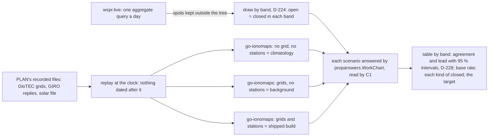

# The M1 and M4 instrument: design, and the forks it needs ruled

Up: [plan, W10.3](../04-development/implementation-plan.md) · [problem statement, M1 and M4](../01-objectives/problem-statement.md) · [dry run](dry-run.md) · [rulings](../02-analysis/rulings.md)

**Where this stands (2026-10-18).** D-208 puts the M1/M4 scorer's baseline inside BUILD: the
climatology's agreement with WSPR, the shipped build's, and a column for the background alone (B-F7).
This page is the instrument's design and, below, what was built. **Its four forks are ruled, each as
recommended: A2 (D-218), B1 (D-219), C1 (D-220), D1 (D-221).** The instrument is built to them
(`tools/reachscore`, batch 45, A-74). **Its dry run on PLAN's week (below) misses both targets under
either draw. It showed that B1 as ruled cannot grade M1, so the graded run draws by band alone (fork E,
D-224).**

## What is already fixed

| | | Ruled by |
|---|---|---|
| The reference circuit | SSB voice, 100 W, simple antennas, **+13 dB SNR in 2.5 kHz** (ITU-R F.339-8, J3E just usable, stable) | D-73, D-91 |
| WSPR as the observation | a spot counts toward "would carry voice" when its SNR, normalised to 100 W from its reported power (`snr + (50 - power_dBm)`), is at least +13 dB; WSPR's SNR is in 2500 Hz and WSPR is constant-envelope | D-73, D-91 |
| The window | the answer for the UTC hour, matched within ±1 h | M1, M4 |
| The set | at least 200 scenarios per metric, both outcomes, at least 3 days, reported by band | D-99 |
| The target | the climatology's agreement plus 5 points; if the climatology is above 90 %, "no worse than climatology"; a miss comes to the HUM LEAD at VALIDATE | D-99, D-118 |
| M1's scenarios | the tower, a place in its served area, the hour, the band | M1 |
| M4's scenarios | the listener's place, a target place, the hour, the band | M4 |

## The columns

Each scenario is answered three ways, on the same set:

1. **The climatology alone** (PyIRI's, as go-ionomaps carries it): the baseline the target is set against.
   It needs no live input, so any day can be answered.
2. **The background alone**: NOAA's GloTEC and the climatology, no stations assimilated (B-F7, D-214's
   "None"). It needs the day's GloTEC grids.
3. **The shipped build**: GloTEC, the climatology and GIRO's stations, as watchpost answers. It needs the
   day's grids and the stations' readings.

Each is the chart's answer for the band at the hour, read as open or closed by fork C.

## The forks

### A. What evidences "closed"

M1 and M4 need both outcomes, and WSPR reports only what was heard.

| | Option | For | Against |
|---|---|---|---|
| A1 | **A spot heard below +13 dB normalised** is "would not carry voice": closed for the reference circuit | it is a measurement on that very path and hour; it is exactly the threshold the circuit sets | its negatives cluster near the threshold, where every model is least certain |
| A2 | A1, **and a pair monitored but not heard**: the transmitter spotted by others on the band in the window, the receiver reporting others on the band in the window, and no spot between them | negatives far from the threshold; closer to "the band was closed" | an unheard pair can be the antennas, local noise or the schedule, not the ionosphere |
| A3 | A2's monitored pairs alone, A1's spots counted as heard | | counts a path that carried a signal as closed, which is not what the circuit asks |

**Recommended: A2, the two kinds of negative reported in separate columns as well as together**, so the
agreement is not won or lost by which kind dominates. **Strongest counter-argument:** a monitored pair's
silence is weaker evidence than a measured weak spot, and folding it in may flatter whichever model
calls more paths closed.

### B. How scenarios are drawn

| | Option | For | Against |
|---|---|---|---|
| B1 | **Stratified by band and UTC hour, balanced between outcomes**, drawn at random within each stratum from the days' pairs | a constant answer scores 50 % (the anti-solution checks, `uat-protocol.md:34`); every band and hour is represented | the balance is not the real base rate, so agreement here is not "how often watchpost is right" |
| B2 | At random from all pairs, the base rate as it falls | agreement reads as accuracy in use | a model that always says "closed" at night can score high on base rate alone |

**Recommended: B1, with the base rate reported beside it.** M1's tower is a WSPR transmitter in the
mainland US and its served area the receivers within the service radius (D-195); M4's pairs are any US
listener and the six continents' reference points' regions (FR-1.9), so M4 tests the paths the chart
answers. **Strongest counter-argument:** WSPR's stations are not where listeners and towers are, so the
set measures WSPR's geography.

**Amended by D-224 (fork E, below):** the graded run draws by band alone, balanced in each band, the
hours as they fall; B1's band and hour strata grade no band-and-hour model on M1.

### C. How a chart answer is read as open or closed

| | Option |
|---|---|
| C1 | **Open or disturbed is "reaches"; absorbed, too weak and above the upper limit are "does not"**, as the words and `Usable` already read them (D-73: disturbed is degraded, not closed) |
| C2 | Disturbed counted as closed |

**Recommended: C1**, the reading the product already shows. **Strongest counter-argument:** a band
disturbed by D-RAP may well fail +13 dB, and C1 counts it as reaching.

### D. Which days

| | Option | For | Against |
|---|---|---|---|
| D1 | **The instrument built and its dry run on PLAN's week now** (its GloTEC and GIRO data are kept with the PLAN evidence, outside the tree; WSPR spots for those days from wspr.live); **the graded measurement on the fresh days beside REVIEW**, with G10.4's fetch (D-132, D-208) | the baseline inside BUILD as D-208 asks; the grade on days nothing was tuned on | two runs |
| D2 | Everything on PLAN's week | one run, now | PLAN's week chose the hybrid and set the targets (D-132's reason): the grade could not fail |
| D3 | Everything on fresh days, beside REVIEW | the cleanest grade | no baseline inside BUILD, against D-208 |

**Recommended: D1.** **Strongest counter-argument:** a baseline on PLAN's week may not be the baseline
on the fresh days, so the "+5 points" could be judged against the wrong climatology figure; D1 answers
that by reporting the climatology on both.

## What the instrument would send

wspr.live, as PLAN did (`dry-run.md`, "Requests made"): **aggregate and filtered SQL**, one query a day
and band at most, the spots' fields only (time, band, the two locators, power, SNR), for the US mainland
and the continents' regions; nothing else is fetched for the dry run. The spots, like PLAN's, stay
outside the tree with the PLAN evidence.

## As built: `tools/reachscore` (batch 45, A-74)

A Go tool with two commands. `spots` sends wspr.live the day's one query and keeps the answer outside the
tree. `score` reads the spots, draws the set by band (D-224; B1's band and hour with `-strata band-hour`), answers each scenario three ways through go-ionomaps
by replaying the days' recorded files, reads each answer by C1, scores by A2, and prints the table by
band. It keeps the scenarios and the inputs' checksums outside the tree as well. The table names the
tool's commit and says whether the tree was clean; figures are cited only from a clean, committed tree
(E-19).

**What it sends.** wspr.live is sent one query a day: the spots heard by receivers in the mainland US,
on the ten bands go-ionomaps answers, from transmitters in the US or within the region of a continent's
reference point. The query aggregates them per pair of locators, band and hour, keeping the count and
the strongest SNR normalised to 100 W. **Locators are fetched, never callsigns**, which is all "the spots'
fields" above names. Each day's window runs from 23:00 the day before to 23:00, covering every scored
hour's ±1 h. The courtesy matches D-39's for GIRO: one query at a time, 15 s apart, and after a refusal
60 s doubling to 15 minutes before the day is given up. A day already kept is never asked for again.
The request log keeps the rate headers alone (D-83).

**The replay.** One library per column runs through the days hour by hour, as a host left running would,
making the stations' burst when it is due. The replay answers from the recorded files at the library's
clock:
- GloTEC's index lists only the grids valid by then.
- The solar file holds only the days before.
- A station's reply is cut to the window asked and the clock, in the columns go-ionomaps asks for, with
  the line naming the original requester left out.

It never serves anything dated after the clock. Any address it does not know fails the run. It also
checks each column was fed as the column says: no grid in the climatology's, and no station's reading
outside the shipped build's.

**The scored hours.** Every third UTC hour, with the clock at 35 minutes past: PLAN's week kept a grid
every three hours, at 5 past (`dry_fetch.py`). That makes each scored hour's grid the newest one, and
well within go-ionomaps' hour.

**The instrument's settings (A-74), which shape the set and are put to the HUM LEAD with the dry run's
figures:**

| Setting | Value | Why |
|---|---|---|
| The ground wave's reach | pairs under 50 km are not drawn | PLAN's own cut (`dry-run.md`, "ground wave removed") |
| M1's served area | receivers 50 to 161 km from the tower, answered for a 161 km service radius | 161 km is the largest service radius ruled (100 mi); the default 25 mi (40 km) lies inside the ground wave's reach |
| M4's targets | transmitters within 1000 km of a continent's reference point | the regions the chart's six targets stand for (FR-1.9) |
| M4's listener | answered with the 400 km near-vertical radius | the Setting's default |
| The draw | by band alone, at most 80 of each outcome per band, seed 19 (D-224); `-strata band-hour -k 10` gives D-219's first draw | the size B1's ten per band and hour made; the seed fixes the set |

**What the dry run cannot say.** PLAN's week kept no D-RAP table and no scales file, so every column
lacks a disturbance: "disturbed" is never said, and C1's reading of it is not exercised. The solar file
PLAN kept begins on 2026-09-06, so the early days' F10.7 means average fewer than 30 days. A locator
names a square rather than a station: two stations in one square count as one, and a 4-character
locator is a square about 110 by 170 km in the US. "Monitored" means monitored by the US receivers the query
keeps.

## The dry run: PLAN's week, B1 as ruled (2026-10-18)

The run used `reachscore` at `997f8471` on a clean tree, with seed 19 and k = 10. Its inputs were 56 grids,
39 GIRO replies, the solar file and 7 days' spots (seven requests to wspr.live, each answered 200). The
inputs' checksum is `ade16837...db7ad`. Every column was fed as it says: no grid in the climatology's
column, and on average 36 stations assimilated in the shipped build's.

| | Scenarios | Climatology | Background | Shipped | The target (D-99) |
|---|---|---|---|---|---|
| M1 | 1594 (797 open, 399 weak, 398 unheard) | 50.4 % | 50.7 % | 50.4 % | 55.4 %: **missed** |
| M4 | 1504 (752 open, 377 weak, 375 unheard) | 58.4 % | 60.7 % | 60.7 % | 63.4 %: **missed** |

Open pairs are 7.4 % of M1's pairs and 4.0 % of M4's, which is the base rate. By kind, under this draw
every column agrees with fewer than 40 % of the open pairs and with 72 to 91 % of the closed ones; by band
alone (below), with 29 to 52 % of the open pairs and 72 to 92 % of the closed.

**What M1's 50 % is.** The model behaves as the physics says. Over the served area, 40 m reaches by US
day (15 to 21 UTC) and not at night. 80 m reaches at night and is absorbed at midday. 30 m and above
never reach near-vertical: foF2 stays under 10 MHz. But within one hour a 161 km served area gets
nearly one answer, and B1 balances open against closed **within each hour**. An answer that is constant
within the hour therefore scores exactly 50 %, whichever way it falls. The scenarios show it: 40 m at
15 UTC reaches 8 of 10 open pairs and 8 of 10 closed ones. So under B1 as ruled, **no model whose
answer depends on band and hour can exceed the climatology by 5 points on M1**, and every model the
product could use is one. M4 escapes in part, because its paths differ in length and direction within
the hour.

**What it is not.** Within an hour, what separates a pair heard from a pair unheard is the stations:
their antennas, power, schedules and local noise. No ionospheric model can know that. The run shows
the model neither right nor wrong on M1. It shows that B1 as ruled measures what the model cannot answer.

The instrument can also draw its strata by band alone (`-strata band`), so the hours fall as they come
and an answer that knows the hour can show it. A constant answer still scores 50 % within each band.

## The dry run by band alone (2026-10-18)

The run used `reachscore` at `d56225bf` on a clean tree, with `-strata band -k 80` (the same size of set),
seed 19, and the same inputs and checksum.

| | Scenarios | Climatology | Background | Shipped | The target (D-99) |
|---|---|---|---|---|---|
| M1 | 1600 | 53.4 % | 53.4 % | 53.4 % | 58.4 %: **missed** |
| M4 | 1600 | 64.2 % | 66.8 % | 66.9 % | 69.2 %: **missed** |

With the hours left in, M1 gains on 40 m and 60 m (63 to 68 %), but the six bands from 30 m up stay at
50 % under either draw. Near-vertical, those bands never reach (foF2 under 10 MHz). WSPR hears 1.4 to
3.3 % of their pairs: sporadic E, scatter or ground wave, none of which the model claims to answer.
Balancing makes those few half of each band's set.

On M4 the shipped build leads the climatology by 2.6 points, and by 2.3 under B1 as ruled. The
background alone carries the lead (GloTEC); the stations add about nothing on these paths.

**Neither draw reaches D-99's +5 points on either metric.** No floor rides on M1 or M4 (D-75), so a miss
comes to the HUM LEAD at VALIDATE with its evidence (D-118); the graded run is on fresh days beside
REVIEW (D-221). What remains to rule now is the draw that graded run uses: the fork below.

## Fork E: the draw for the graded run

| | Option | For | Against |
|---|---|---|---|
| E1 | **B1 as ruled** (band × hour, balanced) | already ruled; the anti-solution holds in every hour | M1 is 50 % for any band-and-hour model by construction: it cannot grade M1 |
| E2 | **By band alone, balanced** (`-strata band`) | a constant answer still scores 50 % in each band; the hour's signal, all a served area's answer can carry, counts | the upper bands' few skywave-free opens still fix six of M1's ten bands at 50 % |
| E3 | E2, **M1 graded on the bands near-vertical answers (160 m to 40 m)**, the rest reported | M1 is graded where the model makes a claim | narrows M1 after seeing the data |
| E4 | B2, the base rate as it falls | agreement reads as accuracy in use | open is 4 to 7 % of pairs, so "always closed" scores 93 to 96 % and D-118's "no worse than climatology" applies: the target says little |

**Ruled E2 (D-224, "E2 band only (Rec.)"), amending D-219:** the graded run draws by band alone, and
`-strata band` with 80 of each outcome per band is the instrument's default. The per-band table already
shows which bands carry the grade.
**Strongest counter-argument:** E3 is the honest reading of what near-vertical answers claim. E2 lets
six bands at a forced 50 % dilute M1's grade. The cost of E3 is choosing M1's bands after seeing these
figures, on the week the targets were set on.
