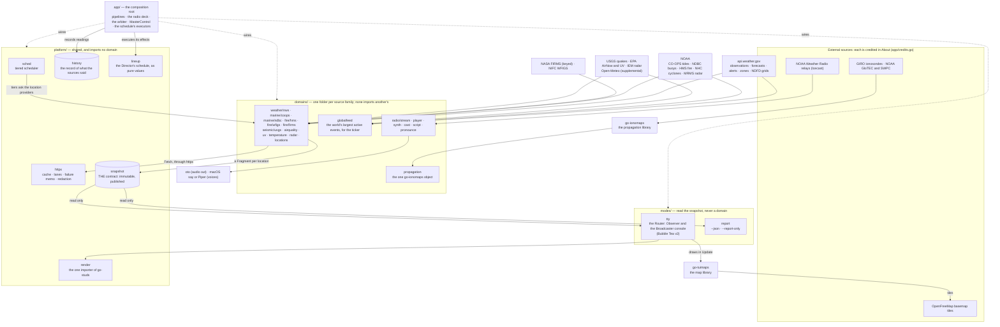

# The shape of watchpost

This page is the program as it is built: what feeds it, what holds the data, what draws it, and the
one rule that keeps those apart. The design history behind each part is in its release's documents
under `06_docs/02_features/`. This page and the as-built maps are what the architecture atlas
(`06_docs/architecture-atlas.html`) renders.

## The program

## The rules the shape keeps

- **`modes/` and `platform/` import no domain** (`make lint-imports`). A domain writes the snapshot,
  and everything the surfaces need from a domain arrives as a hook in `tty.Config`, wired by `app`.
- **`platform/render` is the one package that imports go-studs** (0.19.5 D-10, `make lint-imports`).
  A surface that needs a table or a row asks for a render function.
- **One deck, one air.** Both surfaces read through the same radio deck in `app`. The Director
  (`platform/lineup`) orders what is read, and MasterControl gates the deck from the air. The
  Broadcaster always has the air while it is on screen. Its five roles, the Card Producer, the Card
  Composer, the Director, the Reader and MasterControl, are defined in `docs/where-things-happen.md`'s
  vocabulary. The as-built picture is
  `06_docs/02_features/0.16.0-broadcaster-ui/03-architecture-design/as-built-air-and-deck.md`.
- **The snapshot is immutable once published.** A frame reads one snapshot, and a newer one replaces
  it whole.

## A map of the packages

The main packages. `platform/` has 24; the rest are small helpers, each with a package comment
(`go doc ./platform/<name>`).

| Where | What lives there |
|---|---|
| `cmd/watchpost` | the command line: flags, the one-shot reports, and the dashboard's start |
| `app/` | the composition root: the PRIORITY and RECENT pipelines (`app/pipelines.go`), the ticker (`app/ticker.go`), the radio deck (`app/radio.go`), the arbiter (`app/arbiter.go`), MasterControl (`app/mastercontrol.go`), the schedule and its executors (`app/schedule.go`, `app/executors.go`), the map's builders and feeds (`app/maps.go`, `app/maplayers.go`), the history recorder (`app/history.go`) |
| `domains/` | one folder per source family, each a `snapshot.Provider` or a source a pipeline asks; see the diagram |
| `platform/snapshot` | the data contract every reader consumes, and the assembler that merges the fragments |
| `platform/report` | what a location report can be made of: the report kinds, each one row in `all()`, and the only place a kind is described |
| `platform/sched`, `platform/httpx` | when a provider is asked, and how a request is made, cached and redacted |
| `platform/history` | the local record of readings, hourly and rolled up, for trends |
| `platform/lineup` | the Director's schedule: cards, tracks, and the events that move them |
| `platform/render` | every formatter, table and glyph set; the go-studs seam |
| `platform/config` | `config.toml`: load, validate, and the one serialized writer |
| `platform/geo`, `platform/propanswers` | shapes and bearings; the Propagation mode's answers |
| `modes/tty` | the live program: the Router, Observer's dashboard and windows, the Broadcaster console, the map pane |
| `modes/report` | `--json` and `--report-only` |
| `pkg/schema` | the published JSON Schema of the report |
| `tools/` | the gates' own instruments (authoring, dupes, wires, atlas, ids and the rest) |

**Comments cite the original design,
[`06_docs/02_features/watchpost-cli/03-architecture-design/architecture.md`](../06_docs/02_features/watchpost-cli/03-architecture-design/architecture.md), as "watchpost-cli architecture §n".**
It was approved before the first build, and its sections are the contracts the oldest packages were written
to: the snapshot (§2, §10.1), the scheduler and the client (§3), rendering (§4), the radio (§5),
the terminal and the CLI (§6), the schema policy (§10.3) and config (§10.11). Its diagrams are that
release's design; this page is the program as it stands.

Where a particular thing happens, step by step, is `docs/where-things-happen.md`. How to add a
detail row, a provider, a radio control, a report kind, a map layer, a Setting, a spoken phrase or a line on a Broadcaster card is
`docs/extending.md`.
